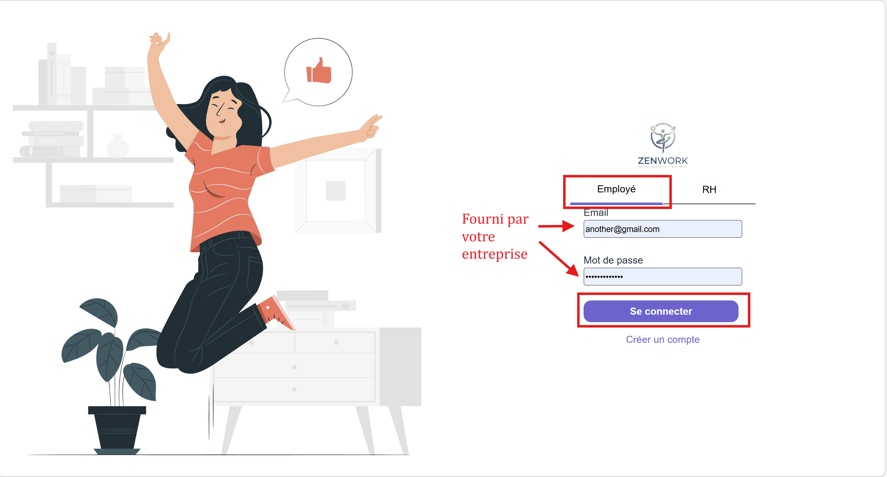
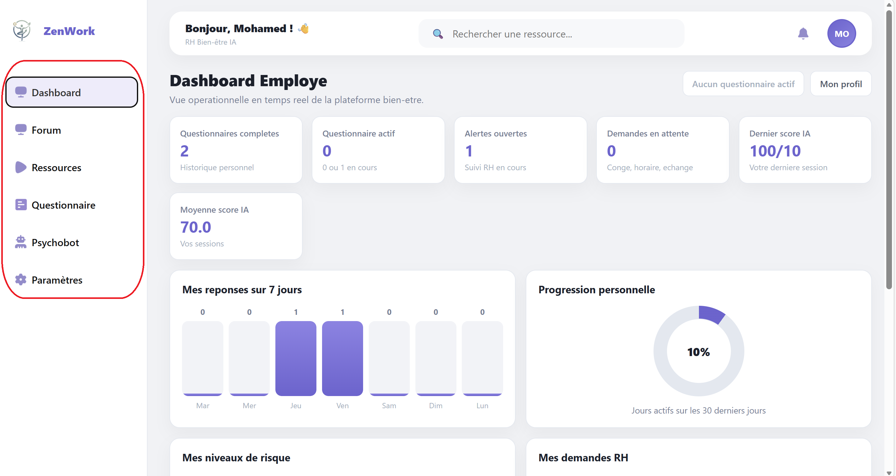
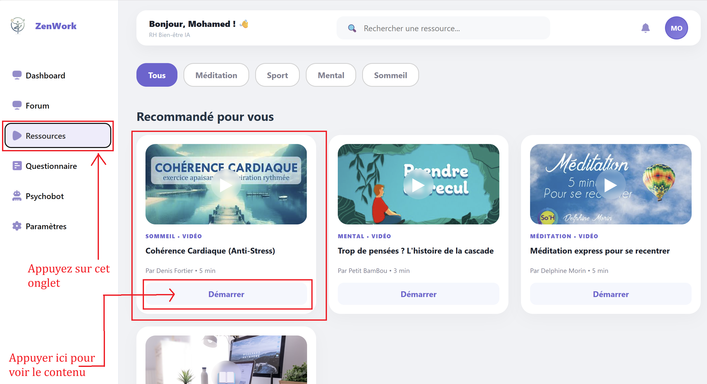
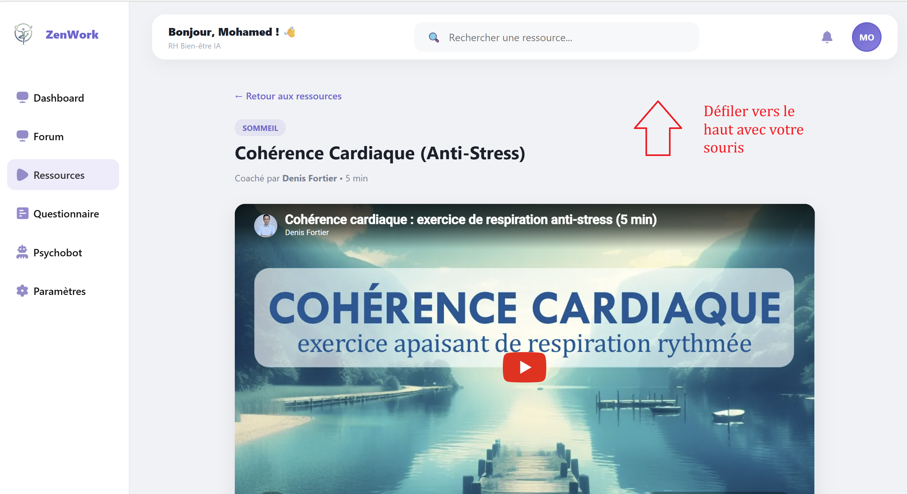
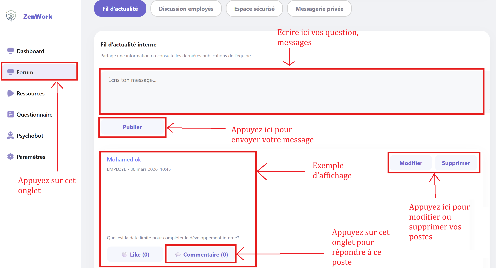
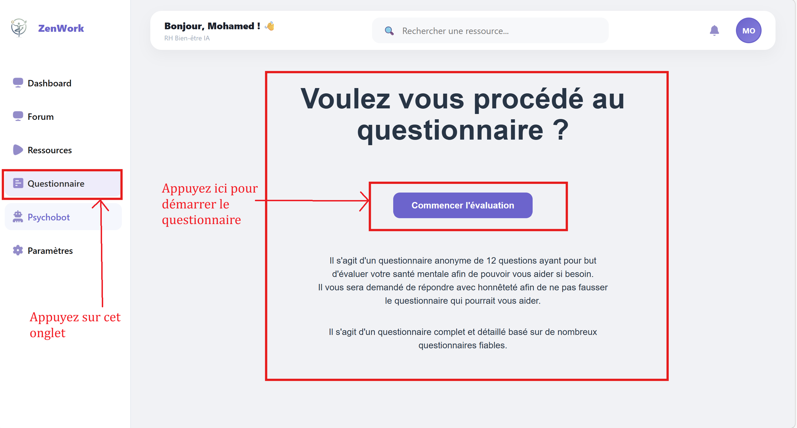
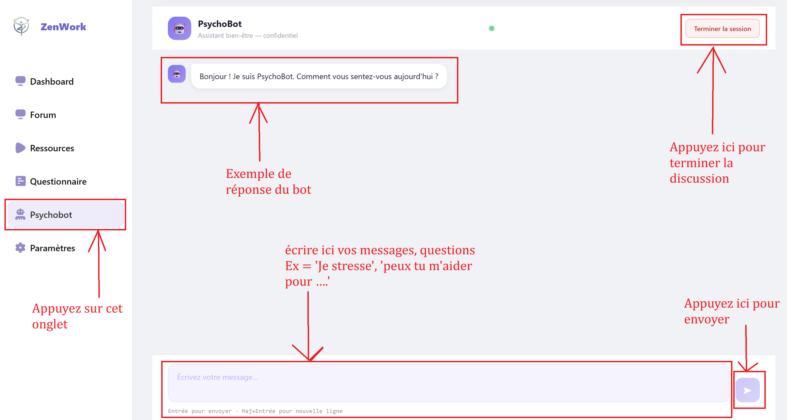
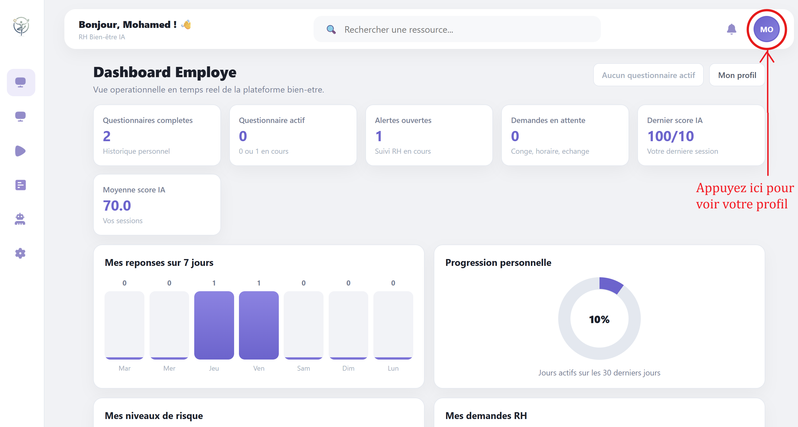
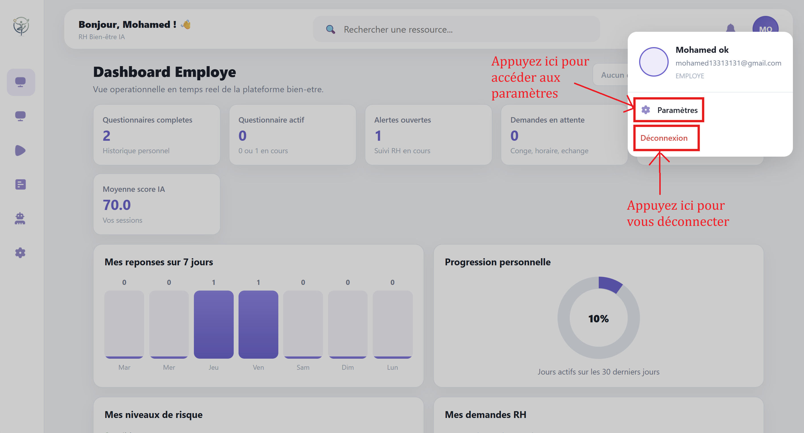

Manuel Utilisateur : Plateforme ZenWork

Bienvenue sur ZenWork, votre espace dédié au bien-être mental et à l'épanouissement au travail. Ce manuel vous guidera pas à pas pour prendre en main la plateforme et profiter de tous ses outils.

1. Connexion à la plateforme
Pour accéder à votre espace personnel, rendez-vous sur la page d'accueil de ZenWork.

Sélectionnez l'espace Employé.

Entrez vos identifiants fournis par votre entreprise.

Cliquez sur le bouton de connexion.

2. Découverte de l'interface
Une fois connecté, vous arrivez sur votre environnement de travail. La navigation se fait très simplement grâce au menu latéral gauche (Sidebar) :

Dashboard : Votre tableau de bord principal avec un résumé de votre activité.

Forum : L'espace d'échange avec vos collègues.

Ressources : Votre médiathèque bien-être.

Questionnaire : L'outil d'évaluation pour suivre l'évolution de votre bien-être mental.

Psychobot : Votre assistant virtuel d'écoute.

Paramètres : La gestion de votre compte.

3. L'Espace Ressources (Vidéos et Articles)
Cet espace vous propose des contenus courts (environ 5 minutes) pour vous aider à gérer votre journée (stress, concentration, sommeil).

Comment trouver une ressource ?

Cliquez sur Ressources dans le menu de gauche.

Utilisez les boutons de filtres en haut (Mental, Sommeil, Méditation, etc.) pour trier les contenus selon votre besoin immédiat.

Sur la carte qui vous intéresse, cliquez sur le bouton Démarrer (pour une vidéo) ou Lire (pour un article).

Visionner une ressource :
La vidéo ou l'article s'ouvrira directement au centre de votre écran. Vous n'avez pas besoin de quitter ZenWork. Une fois terminé, cliquez simplement sur le bouton "← Retour aux ressources" en haut à gauche pour revenir à la grille.

4. Le Forum de discussion
Le forum est un espace bienveillant pour échanger avec vos collaborateurs.

Cliquez sur Forum dans le menu.

Vous pouvez lire les sujets existants ou créer une nouvelle discussion pour poser une question ou partager une astuce bien-être.

5. Les Questionnaires (Bilan Bien-être)
Pour vous aider à faire le point sur votre état d'esprit et vos conditions de travail, ZenWork met à votre disposition des évaluations régulières. Ces bilans permettent à la plateforme de vous recommander les meilleures ressources.

Comment remplir un questionnaire ?

Cliquez sur "Questionnaires" dans le menu latéral.
Cliquez sur le bouton pour démarrer l'évaluation disponible (ex: *Bilan mensuel*, *Niveau de stress*).
Laissez-vous guider et répondez aux questions avec sincérité. 
À la fin du questionnaire, vos résultats sont enregistrés et vous recevrez des recommandations personnalisées.

6. Le Psychobot (Assistant Virtuel)
Si vous ressentez le besoin de vous exprimer ou si vous traversez un moment de surcharge mentale, le Psychobot est là pour vous écouter 24h/24 et 7j/7.

Cliquez sur Psychobot dans le menu.

Tapez votre message dans la zone de texte. Les échanges sont totalement confidentiels et gérés par notre Intelligence Artificielle pour vous proposer des exercices de relaxation ou des conseils adaptés.

7. Gérer son profil et se déconnecter
En haut à droite de votre écran se trouve l'icône de votre profil (vos initiales).

Cliquez dessus pour ouvrir le menu rapide.

Cliquez sur Paramètres pour modifier vos informations (Nom, Prénom, mot de passe).

Cliquez sur Déconnexion pour fermer votre session de manière sécurisée à la fin de votre journée.

